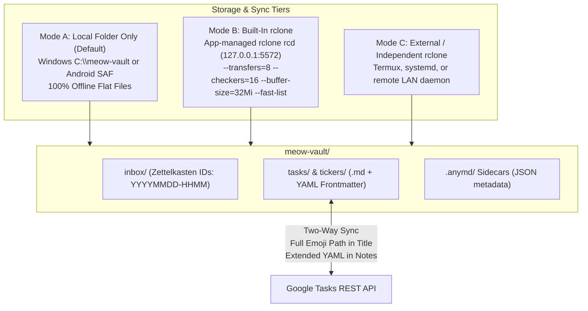
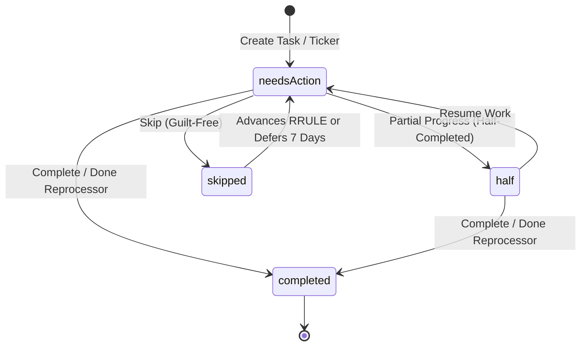

# (=^･ω･^=) My Black Box (MBB) & AnyMD Extension Architecture

```text
  /\_/\  
 ( o.o )  MY BLACK BOX (MBB) FLIGHT RECORDER
  > ^ <   AuDHD Somatic Telemetry, Retrospective Analysis & Task Engine
```

> **MBB (My Black Box)** is a local-first personal flight-data recorder and retrospective log ("why did my plane go down") designed for AuDHD executive function, cognitive offloading, and somatic milestone tracking. MBB is implemented as a clean, modular, toggleable extension bundle (`extensions/mbb/`) hosted inside **AnyMD** ([t3hkitty/anymd](https://github.com/t3hkitty/anymd)).

---

## 📑 Table of Contents
1. [Project Identity & Core Philosophy](#1-project-identity--core-philosophy)
2. [Storage, rclone, & Sync Tiers](#2-storage-rclone--sync-tiers)
3. [AnyMD Extension Host Contract (`extensions/mbb/`)](#3-anymd-extension-host-contract-extensionsmbb)
4. [Telemeowtrics On-Device Black-Box Collectors (`net.artkitty.telemeowtrics`)](#4-telemeowtrics-on-device-black-box-collectors-netartkittytelemeowtrics)
5. [Tasks.org-Parity Engine, Anti-Overwhelm States & Emoji Folder Scaffolding](#5-tasksorg-parity-engine-anti-overwhelm-states--emoji-folder-scaffolding)
6. [Roman Numeral Completion Tickers, Superseding States & Stage Director](#6-roman-numeral-completion-tickers-superseding-states--stage-director)
7. [Repository Structure & Standalone Usage](#7-repository-structure--standalone-usage)

---

## 1. Project Identity & Core Philosophy

- **Scope Boundary (MBB = Tasks & Routines, Not Vaultr)**: MBB is strictly focused on task management, Google Tasks (`gtasks`) bidirectional sync, and Android Tasker/MacroDroid integration (`kittlibr://capture` / `MBB.prj.xml` intent flows). All heavy file storage and seedbox operations belong to `vaultr`; MBB UI and workflows are cleanly decoupled from `vaultr`.
- **Decluttered 3-View Architecture**:
  1. `⚡ Tasks` (Default): Slim Quick Capture + scannable, collapsible task list grouped by priority/due state, concise tag filter chips, and interactive ASCII Pet Companion.
  2. `🔄 Sync & Automations`: Unified Google Auth AIO card, Google Tasks (`gtasks`) two-way sync controls, and direct Tasker/MacroDroid intent automation mappings.
  3. `📋 Diagnostics & Logs`: Token debug inspector, raw JSON payloads, and verbose activity/API diagnostic logs isolated from the primary workspace.
- **Personal Flight Recorder**: Captures passive background context, active micro-actions, and somatic triggers so you can retrospectively diagnose cognitive crashes, energy slumps, and hyperfocus loops without manual logging friction.
- **Zero-Server / Laptop-Off Baseline**: All state lives in flat `.md` files with human-readable YAML frontmatter and `.anymd` directory sidecars inside `meow-vault`. Operates 100% offline via local filesystem paths (`C:\meow-vault` on Windows) or Android Storage Access Framework (SAF directory picker). No VPS, Docker daemon, database server, or SQLite lock-in required.
- **Tech Stack Rules**:
  - **Python (Standard Library Preferred)**: Compatible with `C:\Scripts` (Windows PowerShell/CMD) and Termux (Android). Used for CLI helpers, sync adapters, and background daemon automation.
  - **TypeScript & React**: Scoped strictly to AnyMD UI modals, Settings panels, and extension mount slots (`extensions/mbb/`).

---

## 2. Storage, `rclone`, & Sync Tiers

MBB decouples storage and synchronization across three explicit operational tiers:



### Modes Breakdown
- **Mode A — Local Folder Only (Default)**: Zero setup. AnyMD directly queries and writes `.md` files in `meow-vault`. Perfect for offline mobile usage when your PC is turned off.
- **Mode B — Built-In `rclone`**: When cloud backup (Nextcloud, WebDAV, Drive, S3, SFTP) is enabled, AnyMD manages a background `rclone rcd` instance bound to `127.0.0.1:5572`. Uses high-efficiency non-mount sync flags:
  ```bash
  rclone rcd --rc-addr=127.0.0.1:5572 --rc-no-auth \
    --transfers=8 --checkers=16 --buffer-size=32Mi --fast-list \
    --cache-dir="/path/to/writable/cache"
  ```
  Does not require OS drive-letter mounts (e.g. `rclone mount`) or root/FUSE permissions.
- **Mode C — External / Independent `rclone`**: Built-in daemon is toggled off in settings. AnyMD points directly to an independent `rclone` daemon running in Termux, a user cron job, or another machine on the LAN.
- **Two-Way Google Tasks Sync Engine**:
  - Synchronizes tasks and micro-tickers bidirectionally.
  - Keeps the full emoji folder path (e.g., `🤣//jokes/true`) in the Google Tasks `title` field.
  - Serializes extended MBB metadata (`status`, `type`, `roman`, `count`, `rrule`, `defer_until`, `stages_reached`, `stopped_by`) inside Google Tasks `notes` as zero-dependency YAML frontmatter.

---

## 3. AnyMD Extension Host Contract (`extensions/mbb/`)

MBB is packaged as a standard AnyMD extension (`extensions/mbb/`) adhering to the `AnyMDExtensionHost` interface:

```json
{
  "id": "org.anymd.extension.mbb",
  "name": "My Black Box (MBB) Bundle",
  "version": "1.0.0",
  "category": "task-telemetry",
  "entry": "./index.ts"
}
```

### Host Interfaces
- **Vault Storage API**:
  - `readFile(path)`, `writeFile(path, content, frontmatter)`, `deleteFile(path)`
  - `listFiles(folder)`, `queryFiles(query)`, `watch(folder, callback)`
  - `readSidecar(path)`, `writeSidecar(path, data)` (`.anymd/<path>.json`)
  - `getPacificTimestamp(date)`: Returns `YYYYMMDD-HHMM` in America/Los_Angeles timezone.
- **UI Mount Slots**:
  - `quickbar`: Mounts the 1-click floating right-side widget for active Roman numeral tickers and weekly milestones.
  - `taskboard-modal`: Mounts `MBBTaskBoardModal` featuring the hierarchical emoji folder tree, anti-overwhelm filters, and Weekly Stage Rollup bar.
  - `settings-panel`: Mounts the **Stage Director** configuration editor in AnyMD Settings.
- **Intent & Broadcast Router**:
  - Routes deep links: `mbb://ticker/<slug>`, `mbb://state/<state_name>`, `mbb://vault/*`, `kittlibr://capture`.
  - Listens to Android broadcasts: `org.anymd.broadcast.UNIFIED_FIREHOSE`, `org.anymd.broadcast.TASKER_WEBHOOK`.
- **Toggleable Lifecycle**:
  - Can be enabled or disabled with a single switch in AnyMD Settings.
  - When disabled, unregisters all UI slots and intent listeners; AnyMD returns to a pure standalone Markdown editor with zero overhead or lingering hooks.

---

## 4. Telemeowtrics On-Device Black-Box Collectors (`net.artkitty.telemeowtrics`)

Telemeowtrics runs on-device (via Android native services, MacroDroid/Tasker intents, or Python background workers) capturing telemetry streams stamped with `device_id` and Pacific Time Zettelkasten IDs (`YYYYMMDD-HHMM`):

| Collector Stream | Capture Mechanism | Output Frontmatter & Vault Destination |
| :--- | :--- | :--- |
| **Media Scrobbles** | `MediaSession` & notification playback listener | Stamped with track, artist, album, duration, player package into `meow-vault/inbox/YYYYMMDD-HHMM-scrobble.md` |
| **Texts (Sent/Received)** | `SMS_RECEIVED` + `content://sms/sent` + messaging notification triage | Redacted/hashed phone numbers or contact names, timestamp, direction into `meow-vault/inbox/YYYYMMDD-HHMM-text.md` |
| **App Usage & Screen Sessions** | `UsageStatsManager` activity transitions | Screen-on durations, foreground app transitions, launch frequency into `meow-vault/inbox/YYYYMMDD-HHMM-appusage.md` |
| **Notifications & Geofences** | NotificationListenerService + Location zone transitions | Package-filtered alerts, arrive/leave wifi or GPS geofence tags into `meow-vault/inbox/YYYYMMDD-HHMM-geo.md` |
| **Manual Screenshot Transposer** | Quick tile / share sheet capture + on-device OCR | OCR extracted text, app context summary, `#zettelkasten` tags for apps without accessible APIs |

*All incoming captures queue cleanly offline in memory/local storage if the vault is temporarily locked or syncing.*

---

## 5. Tasks.org-Parity Engine, Anti-Overwhelm States & Emoji Folder Scaffolding

MBB provides feature parity with Tasks.org while introducing cognitive accommodations for AuDHD:



### 1. Anti-Overwhelm States
- **Skip (`skip`)**:
  - For recurring tasks: advances `due` to the next RFC 5545 `RRULE` interval and appends `{ action: "skipped" }` to history without marking `completed` or showing guilt-inducing overdue red badges.
  - For one-off tasks: defers `due` and `defer_until` by 7 days.
- **Half-Completed (`half`)**:
  - Sets `status: half`.
  - Displays a visual `🌗` half-filled pill and isolates items in a low-friction "Resume / Half-Done" modal tab.

### 2. Emoji Folder Path Syntax (`<emoji>//<folder>/<subfolders>/<title>`)
- Formatted as `<emoji>//<folder>/<subfolders>/<title>`.
- Example: `🤣//jokes/true`
  - Leading Emoji: `🤣`
  - Folder Tree: `["jokes"]`
  - Clean Title: `true`
  - Synced Google Tasks Title: `🤣//jokes/true`
- Example Frontmatter serialized in note/Google Tasks `notes`:
  ```yaml
  ---
  priority: 2
  tags: ["humor", "mbb"]
  recurrence: "FREQ=WEEKLY;INTERVAL=1"
  defer_until: "2026-11-29"
  status: "needsAction"
  type: "task"
  emoji: "🤣"
  folderPath: ["jokes"]
  cleanTitle: "true"
  ---
  Task notes body text...
  ```

---

## 6. Roman Numeral Completion Tickers, Superseding States & Stage Director

### Roman Numeral Micro-Tickers (`type: ticker`)
Tracks micro-actions (e.g., `💊//medical/Took a sip`) with zero cognitive overhead:
- Minimal YAML tracking: `count: 4`, `roman: "IV"`, `started_at: "2026-11-22T16:00:00Z"`.
- Live canonical Roman numeral conversion: `I`, `II`, `III`, `IV`, `V`, `VI`, `VII`, `VIII`, `IX`, `X`...
- **Done Reprocessor**: On completion, calculates elapsed duration from `started_at` to `completed_at`, appends Stage Director milestone lines, and generates a structured retrospective block in the Markdown body.

### Superseding Auto-Stop States (`emits_state` / `auto_stop_on`)
Allows life events to cascade automatic shutdown of open tickers/timers:
- When an event with `emits_state: ["sleep"]` fires (e.g., `🌙//health/Went to bed`), MBB scans active tasks for `auto_stop_on: ["sleep"]`.
- Matching tickers (e.g., daytime hydration or work sessions) are automatically closed, processed by the Done engine, and marked with `stopped_by: "🌙//health/Went to bed"`.
- Similarly, `🥗//health/Ate lunch` (`emits_state: ["broke_fast", "meal"]`) automatically stops active fasting timers listening to `broke_fast`.

### Stage Director (`stage_director`)
A customizable milestone engine for timers and tick counters:
- **Profile Configuration**:
  - `trigger_type`: `"duration_minutes"` | `"tick_count"`
  - `stages`: List of `{ stage_key, threshold, label, done_message }`
  - Template Tokens: `{title}`, `{duration}`, `{hours}`, `{count}`, `{roman}`
- **One-Click Editable Presets**:
  - **Fasting Preset**: `0h` (Digestion), `6h` (Glycogen Depletion), `12h` (Fat Burning), `16h` (Autophagy Activation), `24h` (Deep Autophagy), `48h` (Peak Autophagy & Immune Renewal).
  - **Workout / Lifting Preset**: `30m` (Warmed Up), `60m` (Solid Session), `120m` ("Achievement unlocked: Deadlifted for two many hours ({duration})").
  - **Hydration Ticker Preset**: `3` ticks (III Awakened), `8` ticks (VIII Super Hydrated).
  - **Blank Custom Preset**: Blank rows for ad-hoc custom metrics.
- **Weekly Stage Rollup**:
  - An aggregate summary bar in MBB calculating crossed milestones across the previous 7 days (e.g., `Autophagy: 5x · Fat Burn: 6x · Solid Session: 4x`).

---

## 7. Repository Structure & Standalone Usage

```text
myblackbox/
├── extensions/
│   └── mbb/                          # AnyMD Extension Bundle
│       ├── extensionManifest.json    # Formal AnyMD manifest
│       ├── index.ts                  # Bundle activation & UI exports
│       ├── types.ts                  # MBB domain types & interfaces
│       ├── roman.ts                  # Roman numeral & duration helpers
│       ├── emojiFolders.ts           # Folder path parsing & tree construction
│       ├── stageDirector.ts          # Stage Director engine & presets
│       ├── mbbFrontmatter.ts         # Zero-dependency YAML serialization
│       ├── mbbEngine.ts              # Tasks.org-parity, ticker, & auto-stop store
│       ├── mbbSyncAdapter.ts         # Google Tasks two-way sync adapter
│       ├── telemeowtrics.ts          # Zettelkasten-ID capture & intent router
│       ├── host/
│       │   ├── AnyMDExtensionHost.ts      # Host manager (storage, router, slots)
│       │   └── AnyMDExtensionHostTypes.ts # Public host interface contracts
│       ├── ui/
│       │   ├── MBBQuickBarWidget.tsx        # 1-click right-side quick bar
│       │   ├── MBBTaskBoardModal.tsx        # Full task board modal + emoji tree
│       │   └── StageDirectorSettingsPanel.tsx # Stage Director settings editor
│       └── README.md                 # Extension bundle specification
├── scripts/
│   └── telemeowtrics_cli.py          # Termux / C:\Scripts offline CLI daemon
├── src/                              # Legacy / standalone webapp modules
└── README.md                         # Main repository architecture doc
```

### Standalone CLI Execution (Termux / `C:\Scripts`)
```bash
# Capture quick note with Pacific Time Zettelkasten-ID
python3 scripts/telemeowtrics_cli.py capture --title "Quick Thought" --text "Ideas for novel chapter"

# Micro-ticker increment
python3 scripts/telemeowtrics_cli.py ticker sip tick

# Emit superseding state to auto-stop open tickers
python3 scripts/telemeowtrics_cli.py state sleep
```
